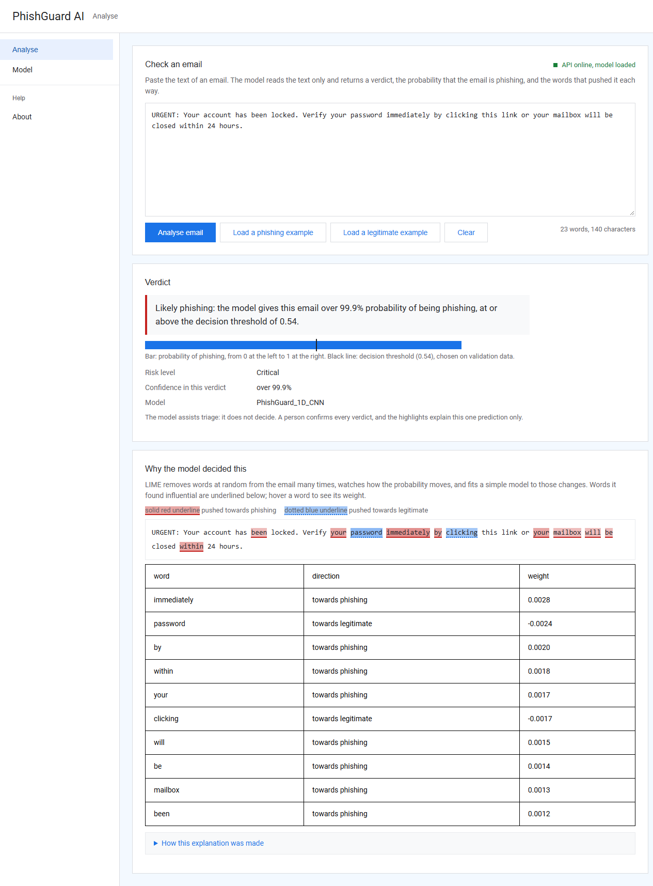
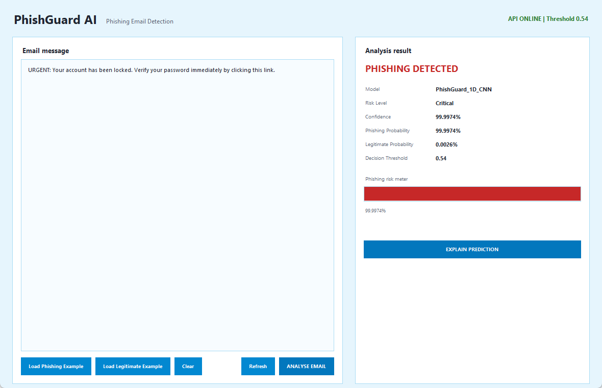

# PhishGuard AI
## AI-Based Phishing Email Detection System

ITRI625 Machine Learning Project

PhishGuard AI is an end-to-end cybersecurity machine learning system that
classifies email messages as legitimate or phishing.

Authors: Lwazi Nhlapo and Colile Sibanda (ITRI625, North-West University, 2026).

Live demo: https://phishguard-b.onrender.com/ui/ (browser UI) and https://phishguard-b.onrender.com/docs (API documentation). The free host sleeps when idle, so the first request after a pause takes about a minute.

## Quick start (Windows)

| Script | What it does |
|---|---|
| `setup.bat` | Creates `.venv` and installs `requirements.txt` (run once) |
| `start_all.bat` | Starts the API, waits for the model to load, then opens the browser UI and the desktop app |
| `start_api.bat` | Starts only the API on http://127.0.0.1:8000 |
| `start_web.bat` | Opens the browser UI at http://127.0.0.1:8000/ui/ |
| `start_desktop.bat` | Opens the Tkinter desktop app |
| `run_tests.bat` | Runs the test suite |
| `open_notebook.bat` | Opens the experiment notebook in Jupyter |

The scripts set `PYTHONUTF8=1`. The saved model's vocabulary is UTF-8 and
Windows Python would otherwise read it with the legacy code page and fail to
load the model. Set it yourself when running the commands below by hand.

The project includes:

- Phishing email dataset preparation
- Logistic Regression baseline
- 1D CNN deep learning classifier
- Train/validation/test experimental design
- Early stopping
- Evaluation metrics and visualisations
- Frozen decision threshold
- FastAPI REST API
- Tkinter desktop application
- LIME Explainable AI
- Browser UI served by the API, with an About page explaining every part
- Security layer: security headers, rate limits, a cap on concurrent explanations
- Automated tests for the endpoints, validation and security layer
- Docker image and Render blueprint for hosting

## Dataset

The project uses the combined Kaggle Phishing Email Dataset:

https://www.kaggle.com/datasets/naserabdullahalam/phishing-email-dataset

Place `phishing_email.csv` in `data/raw/`. The notebook cleans the file,
removes exact duplicates, and creates a stratified 70/15/15
train/validation/test split saved under `data/processed/`.

The raw and processed CSV files stay on the local machine. They are excluded
from Git because of their size.

Labels used by the project:

- `0` — legitimate
- `1` — phishing

## Project Structure

```text
api/                  FastAPI service, frozen-model predictor and security layer
web/                  Browser UI (static HTML, CSS and JavaScript) served at /ui/
tests/                Endpoint, validation and security tests
deploy/               Dockerfile and pinned serving requirements
docs/screenshots/     Screenshots of the running system
data/raw/             Local raw CSV (not committed)
data/processed/       Local train, validation and test CSV files (not committed)
desktop_app/          Tkinter client
models/baseline/      TF-IDF vectoriser and logistic regression
models/deep_learning/ Frozen 1D CNN and validation decision config
notebooks/            Executed experiment notebook
outputs/figures/      Saved evaluation and LIME figures
outputs/metrics/      Metric tables and final evaluation metadata
```

## Installation

From the project root:

```powershell
python -m venv .venv
.venv\Scripts\Activate.ps1
python -m pip install --upgrade pip
pip install -r requirements.txt
```

`environment_freeze.txt` records the package versions used for the experiment.

## Running the API

The API loads the saved 1D CNN. It does not retrain the model.

```powershell
python -m uvicorn api.main:app --host 127.0.0.1 --port 8000
```

Interactive documentation:

http://127.0.0.1:8000/docs

## Browser UI

With the API running, open http://127.0.0.1:8000/ui/ (or run `start_web.bat`).

- **Analyse**: paste an email, get the verdict, the probability against the
  threshold, and the LIME words underlined in the text.
- **Model**: the saved test results for the CNN and the baseline, the loss
  curve and the evaluation figures.
- **About**: what the system is and how each part works, with the details
  behind expandable sections.

## Running the Desktop App

Start the API first, then open a second terminal:

```powershell
python desktop_app/app.py
```

The desktop application sends email text to the API. It does not load or
retrain the machine learning model. To use a hosted copy of the API instead of
the local one, set `PHISHGUARD_API_URL` before starting it.

## API Endpoints

- `GET /` — service status
- `GET /health` — model health check and frozen threshold
- `GET /model-info` — model configuration
- `POST /predict` — phishing classification
- `POST /explain` — local LIME explanation
- `GET /metrics` — the saved final test results
- `GET /ui/` — the browser UI; `GET /figures/...` — the saved evaluation figures

Example prediction request:

```json
{
  "email_text": "URGENT: Verify your account immediately."
}
```

The prediction response includes the predicted class, phishing probability,
legitimate probability, confidence, risk level and frozen threshold.

## Final Model Performance

The final frozen 1D CNN was evaluated once on the independent test set.

| Metric | Score |
|---|---:|
| Accuracy | 98.99% |
| Precision | 98.66% |
| Recall | 99.42% |
| F1-score | 99.04% |
| ROC-AUC | 99.95% |
| PR-AUC | 99.95% |
| False Positive Rate | 1.48% |
| False Negative Rate | 0.58% |

The final decision threshold is **0.54**, selected using validation F1-score
before the independent test set was evaluated.

On the 12,312-email test set the confusion matrix was 5,798 true negatives,
87 false positives, 37 false negatives and 6,390 true positives. These values
are stored in `outputs/metrics/final_test_metrics.csv` and
`outputs/metrics/final_evaluation_metadata.json`.

The logistic regression baseline was also scored on the same test set for
comparison. The notebook records both results. The test set was not used to
tune the model or the threshold.

## Explainable AI

The system includes local prediction explanations using LIME
(Local Interpretable Model-agnostic Explanations).

`POST /explain` returns influential words or phrases and their local
contribution toward the phishing or legitimate class.

After analysing an email in the desktop application, select
`EXPLAIN PREDICTION` to open a LIME explanation window.

LIME explanations are local approximations and should not be interpreted
as causal explanations of model behaviour.

## Security

`api/security.py` adds, on every response, headers that block MIME sniffing,
framing and referrer leaks, and a Content Security Policy that lets the UI load
only its own files. Scoring requests are rate-limited per client and, for
explanations, across all clients; at most two LIME explanations run at once,
since each scores 1 000 copies of the email. Error responses carry a short
message and no internal details. Limits are set with environment variables
listed at the top of the file.

## Tests

```powershell
run_tests.bat
```

or `pytest -q` with `PYTHONUTF8=1` set. The tests load the saved model and
check the endpoints, input validation, the frozen threshold, the security
headers and the rate limiter.

## Hosting

`deploy/Dockerfile` builds one container with the API, the browser UI, the
saved model and the saved results; data and notebooks are left out. On Render,
create a Blueprint from this repository: `render.yaml` points at the Dockerfile
and sets the number of trusted proxies for the rate limiter. The live demo above
runs the `B` branch this way on the free plan: the image starts within a minute
and a LIME explanation takes about 5 seconds.

The Dockerfile was built and run by Render for the live demo. To try the image locally:

```powershell
docker build -f deploy/Dockerfile -t phishguard .
docker run -p 8000:10000 phishguard
```

Then open http://127.0.0.1:8000/ui/. TensorFlow needs roughly 400 to 500 MB of memory, which is close to the limit of a free hosting tier.

## Screenshots

`docs/screenshots/` shows the browser UI, the desktop app, the API docs and
the test run, with a caption for each in its README.





## GitHub / Version Control

The implementation was committed step by step, from the initial project
structure through dataset preparation, the baseline, CNN training, validation,
the locked test evaluation, FastAPI, the desktop application and LIME.

Repository:

https://github.com/Lwazi-Junior/ITRI625-Phishing-Email-Detection
